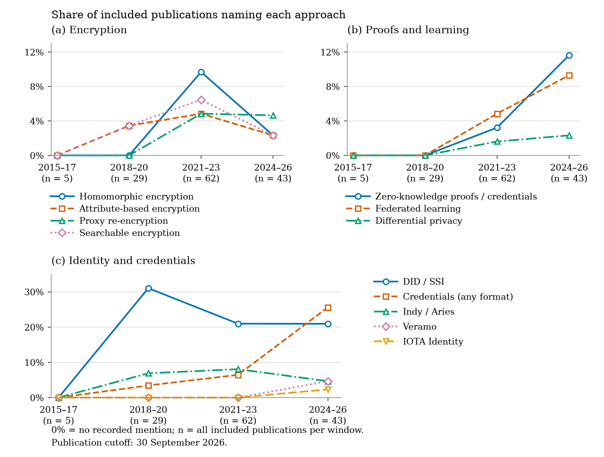

# Blockchain-Aided Data Sharing: Dataset and Analyses of Privacy, Consent, and Identity Management

Data, source records, comparisons, and reproduction scripts for blockchain-aided data sharing. The collection covers privacy, consent and permission management, and decentralized identity.

The [protocol](docs/protocol.md) records the publication cutoff, title queries, eligibility criteria, and scope of the synthesis.

## Explore the collection

| Search-topic group | Included publications | Detailed comparisons | Evaluation records |
|---|---:|---:|---:|
| Privacy | 48 | 14 | 8 |
| Consent and permission | 59 | 28 | 26 |
| Decentralized identity | 32 | 11 | 7 |
| **Total** | **139** | **53** | **41** |

Each publication belongs to one group for counting. Its mechanisms may address more than one topic. Evaluation records describe publications already included in the collection. They do not add studies. The privacy synthesis excerpt discusses seven of the eight retained privacy evaluation records; the InvisiReveal extraction remains available in the dataset.

Start with:

- [Application summaries](data/application-summaries.csv): application and approach descriptions for all 139 publications.
- [Included-publication dataset](data/survey-dataset.csv): bibliographic identities, extraction fields, evaluation descriptions, source locations, and access limits. [Field definitions](docs/data-dictionary.json).
- [Platform comparisons](data/platform-comparisons.json): 19 privacy systems and six identity components, with their roles, protected information, trust assumptions, limits, and reference URLs.
- [Detailed evidence matrix](data/sources/revisao/synthesis-evidence-matrix.csv): 53 included publications and 17 contextual sources. Contextual sources are excluded from the 139-publication total.
- [Included-publication references](data/application-references.bib), [counts](data/counts.json), and [annual totals](data/studies-by-year.csv).

## Reproduce the results

Dataset commands use Python 3.9 or newer and its standard library:

```sh
python3 run.py
python3 run.py --validate
python3 verify_source.py
python3 -m unittest discover -s tests -v
```

For figures, use Python 3.14 and the pinned plotting dependencies:

```sh
python3 -m venv .venv
.venv/bin/python -m pip install -r requirements-plots.txt
.venv/bin/python reproduce_plots.py
.venv/bin/python reproduce_plots.py --validate
```

[REPRODUCE.md](REPRODUCE.md) describes prerequisites, output files, validation results, and optional historical reproduction. No external document or third-party full text is required for these commands.

## Recorded approaches across publication periods



The four period denominators are **5, 29, 62, and 43**, totaling 139 publications. **62 publications** name at least one of the twelve plotted approaches. The other 77 remain in the denominators. A publication can contribute to several series.

The proxy re-encryption count for 2021–2023 is **4 of 62 publications (6.45%)**. Each plotted value can be traced through the [period counts](data/sources/revisao/technology-timeline-periods.csv), [publication annotations](data/sources/revisao/technology-timeline-records.csv), and [matched descriptions](data/sources/revisao/technology-timeline-matches.csv). The [plot method](data/sources/revisao/technology-timeline-method.md) explains matching rules and interpretation limits.

The figure measures recorded mentions. It does not measure adoption, effectiveness, deployment, or the date a technology was invented. A separate illustration of reported processing costs for two included studies is available through the optional plotting command.

## Provenance and limitations

[Collection membership](data/sources/revisao/collection-membership.json) records included identities, inventory assignments, evaluation identities, research questions, and objective citations. [Source fingerprints](data/source-snapshot.json) and the [generated-file manifest](data/manifest.json) identify the retained inputs and outputs.

Use the source locators and evidence boundaries to interpret the reported evaluations. The comparisons apply to the operations and conditions described in the included publications.

The [Apache 2.0 license](LICENSE) applies to this repository. Bibliographic metadata and links do not transfer rights to the cited publications. Third-party full texts and indexed abstracts are not redistributed.
